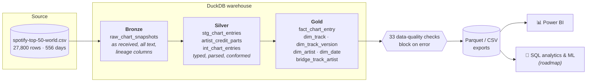
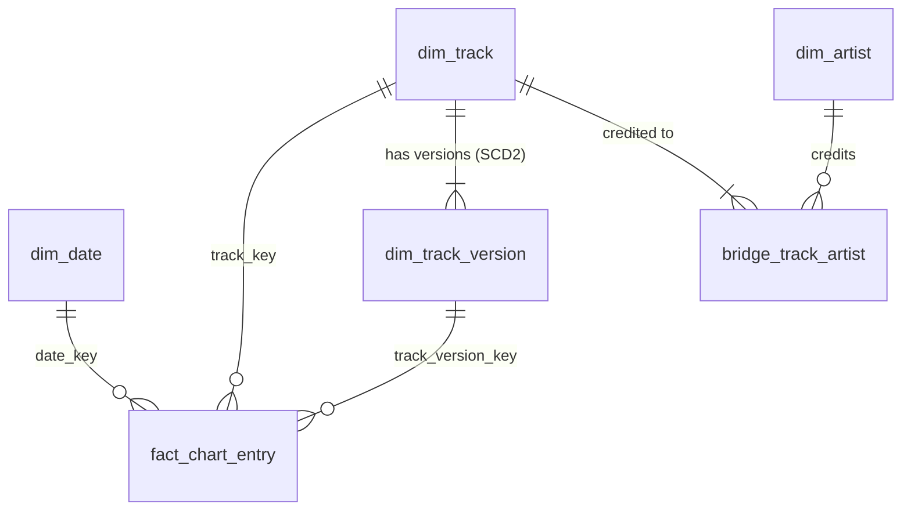

<div align="center">

# 🎵 Spotify Global Top 50: Analytics Platform

### An end-to-end data project: a tested ELT pipeline and star-schema warehouse built on 18 months of daily Spotify charts, feeding a Power BI dashboard.

<p>
  <a href="https://github.com/n3h4a/spotify-powerbi-dashboard/actions/workflows/ci.yml"></a>
  
  
  
  
  
</p>


</div>

---

## 📌 At a glance

| | |
|---|---|
| **Data** | 556 daily snapshots of the Spotify Global Top 50, **May 2023 to Nov 2024** (27,800 chart entries) |
| **Pipeline** | Python + SQL on DuckDB, **bronze → silver → gold** layers, one-command rebuild in under 1 s |
| **Model** | Star schema: 1 fact, 4 dimensions (incl. a **Type 2 slowly changing dimension**), 1 bridge table |
| **Quality** | **33 automated data-quality checks**, run in CI, with a [generated report](docs/data_quality_report.md) |
| **Testing** | 35 unit and integration tests, including tests that corrupt the data on purpose to prove the checks catch it |
| **BI** | Interactive 4-page Power BI dashboard |

---

## 🏗 Architecture



| Layer | What happens | Why |
|---|---|---|
| **Bronze** | The file lands untouched, as text, with source-file and row-number lineage. | Ingestion can never fail on a bad value, and every row is traceable to its source line. |
| **Silver** | Types are cast, release dates parsed, collaboration credits split into individual artists, and each row resolved to a stable track identity. | Cleaning rules live in one place and are unit-tested. |
| **Gold** | Star schema with documented grain and enforced keys. | Ready for BI, SQL analysis and ML features without re-cleaning. |

---

## 🚀 Quickstart

```bash
git clone https://github.com/n3h4a/spotify-powerbi-dashboard.git
cd spotify-powerbi-dashboard
make install   # pip install -e ".[dev]"
make all       # build warehouse → run quality checks → export gold tables
make test      # 35 tests
```

```text
bronze raw_chart_snapshots      27800 rows     91 ms
silver stg_chart_entries        27800 rows     71 ms
silver artist_credit_parts        487 rows    471 ms
silver int_chart_entries        27800 rows     90 ms
gold   dim_date                   731 rows     84 ms
gold   dim_artist                 346 rows      9 ms
gold   dim_track                  807 rows      6 ms
gold   dim_track_version         1079 rows     34 ms
gold   bridge_track_artist       1003 rows     12 ms
gold   fact_chart_entry         27800 rows     68 ms
```

Query the warehouse directly with the DuckDB CLI or Python:

```python
import duckdb
con = duckdb.connect("warehouse/spotify.duckdb", read_only=True)
con.sql("SELECT * FROM gold.fact_chart_entry LIMIT 5").show()
```

---

## 🧩 Data model



**`fact_chart_entry`** has one row per chart day × position, plus chart-movement metrics
computed with SQL window functions: `previous_position`, `position_change`,
`entry_status` (debut / re-entry / returning), `current_streak_days` and
`peak_position_to_date`.

📖 Full reference: **[Data model & design decisions](docs/data_model.md)** · **[Data dictionary](docs/data_dictionary.md)**

### Engineering decisions worth reading

1. **Track identity without a track ID.** One recording's artist credit changes over time (`Drake & SZA` → `Drake`), so `(song, artist)` is the wrong key. Tracks are keyed on *(title, lead artist)*, and a uniqueness check confirms no two recordings collide.
2. **SCD Type 2.** 16% of tracks change attributes while charting, typically when a single is re-released on an album. `dim_track_version` keeps every version with validity windows (gaps-and-islands SQL), so reports reflect what was true *on that day*.
3. **Fair credit for collaborations.** A bridge table with `attribution_weight = 1/n` shares chart metrics between collaborators with no double counting. 18% of chart entries are collaborations.
4. **Missing days don't distort the metrics.** Movement is measured against the previous *snapshot*, so the 4 missing source days don't show up as false drop-outs.
5. **Deterministic keys.** Keys are hashed from natural keys, so rebuilds are idempotent (tested).

---

## ✅ Data quality

Every run executes **33 checks** in 6 categories: completeness, validity, uniqueness,
referential integrity, business rules and source profiling. Any failed `error` check
returns a non-zero exit code and turns CI red. The results go to
**[docs/data_quality_report.md](docs/data_quality_report.md)**, and CI fails if the
committed report is out of date.

**What profiling found in the raw data:**

| Finding | Impact | Handling |
|---|---|---|
| Mixed **CRLF / LF** line endings (first day saved separately) | Strict CSV parsers reject the file | Tolerant bronze read + independent row-count reconciliation |
| **4 missing days** (e.g. 2024-03-14) | Naive day-over-day metrics show false drop-outs | Snapshot-based movement metrics; flagged in `dim_date` |
| Artist credits **drift** for the same recording | Wrong track counts if keyed on the credit | Track = title + lead artist |
| `" & "` joins collaborators **and** appears inside band names (*Earth, Wind & Fire*) | Naive splitting invents artists | Splitting with a configurable protected-names seed |
| Release dates in 3 precisions (`2023-04-28`, `2019-05`, `1962`) | Misleading "days since release" | Normalised date + `release_date_precision` |
| **19 tracks flip** between single and album releases from day to day | Noisy attributes | Faithfully versioned in SCD2; documented |

---

## 📊 Power BI dashboard

<details open>
<summary><b>🏠 Home</b>: navigation hub</summary>
<p align="center"></p>
</details>

<details>
<summary><b>📊 Overview</b>: KPIs, album-type mix, quarterly popularity trend, duration vs popularity</summary>
<p align="center"></p>
</details>

<details>
<summary><b>🎤 Artist analysis</b>: rankings, unique songs, top tracks per artist</summary>
<p align="center"></p>
</details>

<details>
<summary><b>🎵 Song analysis</b>: popularity, duration, best chart position, release year</summary>
<p align="center"></p>
</details>

Open `dashboard/spotify_dashboard.pbix` in Power BI Desktop. The gold tables in
`exports/` (after `make export`) can be loaded directly with the Parquet or CSV
connector.

---

## 📂 Repository structure

```text
spotify-powerbi-dashboard/
├── dataset/                  # raw source CSV
├── seeds/                    # analyst-maintained reference data
├── sql/
│   ├── bronze/               # raw landing
│   ├── silver/               # typing, parsing, conforming
│   └── gold/                 # star schema (facts, dimensions, bridge)
├── src/spotify_pipeline/
│   ├── pipeline.py           # orchestration: ordered, timed, idempotent steps
│   ├── artists.py            # collaboration-credit parser
│   ├── quality.py            # data-quality framework + report
│   └── cli.py                # `spotify-pipeline build | check | export | all`
├── tests/                    # pytest: unit, integration, corruption tests
├── docs/                     # data model, dictionary, quality report
├── dashboard/                # Power BI .pbix
├── screenshots/
├── .github/workflows/ci.yml  # lint → test → build → enforce data quality
├── Makefile
└── pyproject.toml
```

---

## 🗺 Roadmap

- [x] **Phase 1: Data engineering.** Layered ELT, star schema with SCD2, data-quality framework, tests, CI
- [ ] **Phase 2: Analytics.** SQL analysis layer (chart survival, debut position vs longevity, collaboration effect, release-to-peak lag, chart concentration), with the Power BI model rebuilt on the star schema
- [ ] **Phase 3: Data science.** Predict chart longevity from first-week signals (time-based validation, SHAP), plus Kaplan-Meier / Cox survival analysis of chart lifespans
- [ ] Incremental, date-partitioned loads and orchestration once the source grows beyond a single file

---

## 🛠 Tech stack

| Area | Tools |
|---|---|
| Storage & compute | DuckDB (embedded OLAP, columnar) |
| Transformation | SQL (CTEs, window functions, gaps-and-islands), Python |
| Data quality | Custom SQL-assertion framework with severities and a generated report |
| Testing & CI | pytest, ruff, GitHub Actions |
| BI | Power BI (Power Query, DAX) |

---

## 👩‍💻 Author

**Neha Karamchandani**: B.Tech, Information Technology

Interested in data engineering, analytics and data science.

<div align="center">

⭐ If you found this project useful, consider giving it a star!

</div>
