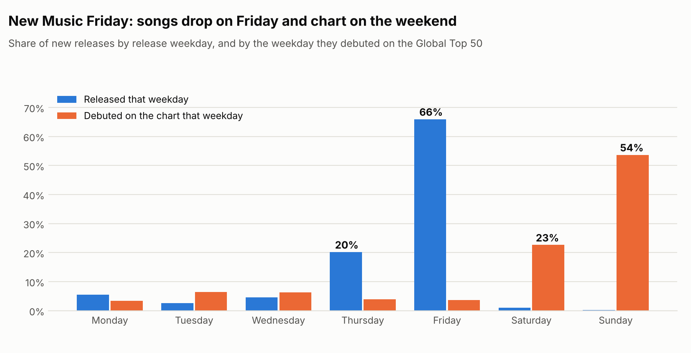
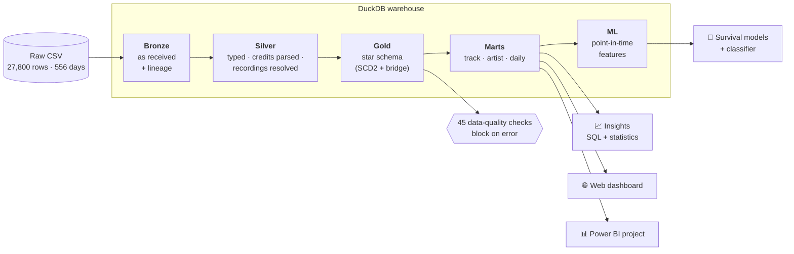

<div align="center">

# 🎵 What Makes a Global Top 50 Hit Last?

### An end-to-end analytics project on 18 months of daily Spotify charts: a tested data pipeline, a star-schema warehouse, nine business questions answered with statistics, a model that predicts a song's chart life one week after debut, and two dashboards.

<p>
  <a href="https://github.com/n3h4a/spotify-powerbi-dashboard/actions/workflows/ci.yml"></a>
  
  
  
  
  
  
</p>

**[▶ Open the live dashboard](https://n3h4a.github.io/spotify-powerbi-dashboard/)** · [Insights report](docs/insights.md) · [Model report](docs/model_report.md) · [Data model](docs/data_model.md) · [Project handbook](docs/PROJECT_HANDBOOK.md)

<a href="https://n3h4a.github.io/spotify-powerbi-dashboard/"></a>

</div>

---

## 📖 The story in one minute

**The question.** Every day Spotify publishes the 50 most-streamed songs in the world. For a
label, an artist's team or a playlist editor, the expensive question is which new songs will
*stay* there, and which will vanish after release week.

**The data.** 556 daily snapshots of the Global Top 50 (May 2023 to November 2024): 27,800
chart entries, 797 songs and 345 artists. The raw file wasn't analysis-ready: it had mixed line
endings, missing days, artist credits that change mid-run, songs listed twice under different
lead artists, and release dates in three different precisions.

**What I built.**
1. A **data pipeline** (Python + SQL on DuckDB) that cleans the file and models it into a
   star schema, guarded by **45 automated data-quality checks**.
2. An **analysis layer** that answers nine business questions with SQL and significance tests.
3. **Survival analysis and a classifier** that predicts whether a song will chart for 30+ days,
   using only its first week (**ROC-AUC 0.91** on unseen 2024 songs).
4. Two **dashboards**: an interactive web dashboard, tested end to end in a real browser, and a
   Power BI project in my original Spotify design.

**The headline.** *A hit's future is written in its first week.* Most songs peak on the day they
debut and are gone within a week. Songs that are still **climbing** after debut last **10x
longer**. A model fed one week of chart movement picks the songs that will last with 82%
precision, against a 29% base rate.

---

## 💼 Business questions answered

| # | Question | Answer | Evidence |
|---|---|---|---|
| 1 | **How long do songs survive on the chart?** | Briefly. The median song charts for **6 days**, 53% last a week or less, and the top 10% of songs hold **57%** of all chart slots. | [Q1](docs/insights.md#q1-how-long-do-tracks-survive-on-the-chart) |
| 2 | **Does a big debut mean a long run?** | No. **Momentum** matters, not height. Songs that climb after debut last **31 days** (median, first 180), against **3** for songs that peak on day one. Debut position barely predicts longevity (ρ = −0.17). | Mann-Whitney U, p < 0.001, effect 0.69 · [Q2](docs/insights.md#q2-which-launch-characteristics-go-with-a-longer-life) |
| 3 | **Do collaborations last longer?** | **No.** 6 vs 6 days (p = 0.96). Features buy reach, not staying power. | [Q2](docs/insights.md#q2-which-launch-characteristics-go-with-a-longer-life) |
| 4 | **Who owns the most chart real estate?** | **Taylor Swift: 6.7%** of every chart slot, 2.1x the next artist. The top 10 artists hold 27%. | collaborations split fairly · [Q4](docs/insights.md#q4-is-the-chart-dominated-by-a-few-artists) |
| 5 | **What happens when a superstar drops an album?** | The chart is taken over for about a week. Taylor Swift held **30 of 50 slots** on 21 Apr 2024, and all five takeovers were album releases. | daily HHI · [Q4](docs/insights.md#q4-is-the-chart-dominated-by-a-few-artists) |
| 6 | **How seasonal is the chart?** | Extremely, at Christmas. Holiday songs held **94%** of the chart on 26 Dec 2023, then **4%** two days later. | [Q5](docs/insights.md#q5-how-seasonal-is-the-chart) |
| 7 | **When do songs come out, and chart?** | **New Music Friday:** 66% of new songs are released on a Friday, and 76% debut on the weekend chart, a median 2 days later. | [Q6](docs/insights.md#q6-when-do-new-songs-come-out-and-when-do-they-chart) |
| 8 | **Which songs ruled #1?** | *Die With A Smile* (Lady Gaga): **77 days**, 57 in a row. *Seven* (Jung Kook) got 75 days across 10 separate runs. 37 songs reached #1. | [Q7](docs/insights.md#q7-which-songs-ruled-the-1-spot) |
| 9 | **Can we tell after one week whether a song will last?** | **Yes.** ROC-AUC **0.91** on 2024 songs the model never saw, against 0.69 using launch-day data only. | [model report](docs/model_report.md) |

<p align="center">
  
  
</p>
<p align="center">
  
  
</p>

### Recommendations

For a label, an artist's team or a playlist editor:

1. **Judge a release on its first week, not its debut position.** Climbing after debut is the
   strongest signal of a long run in this data. The model ranks new songs on exactly that.
2. **Back slow burners.** Songs that reach the chart 1–12 months after release last a median
   21 days, against 6 for brand-new releases. Catalogue deserves promotion budget too.
3. **Don't count on a feature for longevity.** Collaborations last no longer than solo songs.
4. **Plan the calendar.** Avoid releasing into a superstar's album week, when one artist can
   hold 60% of the chart, and expect December to belong to holiday songs.
5. **Release on Friday and watch the weekend.** That is when the chart decides.

---

## 🤖 Predicting a long chart run

**Question:** a song has just entered the Global Top 50. Will it chart for 30+ days?

| Model | Information used | Test ROC-AUC [95% CI] | Precision in top 20% |
|---|---|---:|---:|
| Debut position only | debut position | 0.61 [0.53–0.69] | 41% |
| Launch-day model | 12 features known at debut | 0.69 [0.61–0.77] | 51% |
| **Week-one model** | **+ 7 features from the first week** | **0.91 [0.86–0.95]** | **82%** |

- **Validated the way it would be used:** trained on 2023 debuts and tested on 2024 debuts.
  Model selection happens inside the training set only.
- **No data leakage:** features are point-in-time, and a test rebuilds the warehouse with
  *future* chart days appended and checks that no feature changes.
- **Survival analysis** keeps songs that were still charting when the data ends (censoring)
  instead of dropping them. A landmark analysis at day 7 avoids immortal-time bias: songs that
  climbed in week one chart a median **57 more days**, against **8** for the rest.
- **The statistics are checked too:** a simulation confirms the proportional-hazards check has
  a 4% false-alarm rate and catches real violations. It caught a bug in my first version.

<p align="center">
  
  
</p>

---

## 📊 Dashboards

### Web dashboard: [n3h4a.github.io/spotify-powerbi-dashboard](https://n3h4a.github.io/spotify-powerbi-dashboard/)

A static site (`site/`) with five pages: **Overview, Artists, Songs, Insights, Predictions**,
plus a period filter (all time, a year or a quarter). Search any of 345 artists or 797 songs,
click a bar to drill in, and follow a song's day-by-day chart journey. Every number is
computed from the warehouse export with the same definitions as the Power BI measures.

<table>
<tr>
<td width="50%"><br><b>Artists:</b> chart share by month, discography, and a one-line summary for any of 345 artists</td>
<td width="50%"><br><b>Songs:</b> the daily chart journey of any of 797 songs, its popularity, and its release history</td>
</tr>
<tr>
<td><br><b>Insights:</b> the business questions, answered with charts</td>
<td><br><b>Predictions:</b> model accuracy and a watchlist of recent debuts</td>
</tr>
</table>

> These screenshots are taken from the live site by every deployment (see
> `.github/workflows/pages.yml`), so they always show the dashboard as it currently is.

**Tested like a product.** An end-to-end test opens the dashboard in Chromium and goes through
every period, **every artist page and every song page**, plus search, clicks, links, the
watchlist and navigation. It then checks every number it read against an **independent SQL**
query on the warehouse (`tests/test_web_e2e.py`, also run in CI).

### Power BI: `powerbi/Spotify Charts Analytics.pbip`

The Power BI layer is **built as code**: a Power BI Project (TMDL model + PBIR report)
generated by `make powerbi`, with 9 tables, a bidirectional bridge for collaborations, a marked
date table and **40 documented DAX measures**. The report **reuses my original hand-designed
dashboard**: the generator reads its backgrounds, cards, icons, album-cover "player", navigation
buttons and theme straight from `dashboard/spotify_dashboard.pbix` and re-binds every visual to
the tested star schema. Every report file is validated against Microsoft's published JSON
schemas, and tests check that every visual field, DAX reference and navigation target resolves.
See the **[Power BI guide](docs/powerbi_guide.md)**.

<details>
<summary><b>The original design</b> (built by hand, now powered by the star schema)</summary>
<p align="center">
<br>
<br>
<br>

</p>
</details>

---

## 🏗 How it's built



| Layer | What happens |
|---|---|
| **Bronze** | The file lands untouched, as text, with source-file and row-number lineage. |
| **Silver** | Types cast, release dates parsed, collaboration credits split into artists, each row resolved to one recording. |
| **Gold** | Star schema: `fact_chart_entry`, `dim_track`, `dim_track_version` (SCD Type 2), `dim_artist`, `dim_date`, and a `bridge_track_artist` with attribution weights. |
| **Marts** | One row per track (debut, peak, censoring flags), per artist and per day. Each reconciles exactly to the fact table. |
| **ML** | Point-in-time features for survival analysis and prediction. |

### Hard problems the data threw up, and how they were solved

| Problem in the raw data | What would go wrong | Solution |
|---|---|---|
| A song's **artist credit changes** mid-run (`Drake & SZA` → `Drake`) | One song counted as several | A track is identified by title + lead artist |
| Spotify **re-credited 7 songs** from Kanye West to his duo ¥$, and **re-listed 3** under "Various Artists" | Songs counted twice, credit given to a placeholder | Identical title + duration (to the millisecond) identifies one recording; "Various Artists" never takes credit |
| `" & "` joins collaborators **and** appears in band names (*Earth, Wind & Fire*) | Invented artists | Credit parser with an editable protected-names list |
| Singles are **re-released on albums** mid-run, and the chart flips between the two | Wrong "album vs single" numbers | SCD Type 2 versions, so every entry carries the attributes valid that day |
| **4 missing days** | False "dropped off the chart" events | Movement measured between snapshots, not calendar days |
| Release dates in **3 precisions** (`2024-04-12`, `2019-05`, `1962`) | Misleading release timing | Normalised date + a precision flag |
| Mixed **CRLF/LF line endings** | Strict parsers reject the file | Tolerant landing + independent row-count reconciliation |

📖 [Data model & design decisions](docs/data_model.md) · [Data dictionary](docs/data_dictionary.md) · [Data-quality report](docs/data_quality_report.md) · [Project handbook (the full story)](docs/PROJECT_HANDBOOK.md)

---

## ✅ Quality and testing

- **45 data-quality checks** run on every build (completeness, validity, uniqueness, referential
  integrity, business rules, reconciliation, source profiling). Any blocking failure stops the
  pipeline and turns CI red. The results are published as a
  [report](docs/data_quality_report.md).
- **103 tests**, including:
  - unit tests for credit parsing
  - model behaviour on a hand-built fixture that contains every edge case
  - corruption tests that break the data on purpose to prove the checks catch it
  - a future-data **leakage test**
  - **known-facts tests** (*Espresso* held #1 for 31 days, each chart has one #1, …)
  - Power BI static checks
  - the **browser end-to-end test** of every dashboard page
- **CI** (GitHub Actions) lints, tests, rebuilds the warehouse, regenerates the reports (and
  fails if the committed reports are stale), and runs the browser test.

---

## 🚀 Run it yourself

```bash
git clone https://github.com/n3h4a/spotify-powerbi-dashboard.git
cd spotify-powerbi-dashboard
make install     # Python package + dev, analysis and ML extras
make all         # build the warehouse, run the 45 checks, export the tables
make insights    # answer the business questions → docs/insights.md
make model       # survival analysis + classifier → docs/model_report.md
make web         # export data for the web dashboard
make powerbi     # regenerate the Power BI project
make test        # run the tests
```

To view the web dashboard locally:

```bash
python -m http.server --directory site 8000
```

Then open <http://localhost:8000>.

To open the Power BI project: open `powerbi/Spotify Charts Analytics.pbip` in Power BI Desktop
and click **Refresh**. The data loads from this repository.

---

## 📂 Repository structure

```text
├── dataset/                 raw source CSV
├── seeds/                   analyst-maintained reference lists (protected names, holiday exclusions)
├── sql/
│   ├── bronze/ silver/ gold/  the ELT layers and the star schema
│   ├── marts/               track, artist and daily analytics tables
│   ├── analyses/            one SQL file per business question
│   └── ml/                  point-in-time feature table
├── src/spotify_pipeline/
│   ├── pipeline.py          orchestration: ordered, timed, idempotent steps
│   ├── quality.py           the data-quality framework and report
│   ├── insights.py          statistics, charts and the insights report
│   ├── modeling.py          survival analysis, classifiers and the model report
│   ├── web.py               data export for the web dashboard
│   ├── powerbi.py           Power BI semantic model (TMDL) generator
│   ├── powerbi_report.py    ports the original dashboard design to the new model
│   └── cli.py               `spotify-pipeline build | check | export | insights | model | web | powerbi | all`
├── site/                    the web dashboard (HTML/CSS/JS, ECharts) and its browser tests
├── powerbi/                 the generated Power BI project and its Parquet data
├── dashboard/               the original hand-built Power BI dashboard (.pbix)
├── docs/                    insights, model report, data model, dictionary, quality report, Power BI guide
├── tests/                   pytest suite
└── .github/workflows/       CI and GitHub Pages deployment
```

## 🛠 Tech stack

| Area | Tools |
|---|---|
| Data engineering | Python, SQL, DuckDB, medallion architecture, star schema, SCD Type 2 |
| Analysis | SQL window functions, SciPy (Mann-Whitney U, Spearman), Matplotlib |
| Machine learning | scikit-learn (logistic regression, gradient boosting, permutation importance), statsmodels (Kaplan-Meier, log-rank, Cox PH) |
| BI | Power BI as code (PBIP: TMDL + PBIR), DAX, Power Query M · web dashboard with Apache ECharts |
| Quality | Custom data-quality framework, pytest, Playwright end-to-end tests, ruff, GitHub Actions |

## ⚠️ Limitations

- 18 months of one chart (Global Top 50). Regional charts or songs outside the top 50 may
  behave differently.
- A chart position is a rank, not a stream count, so the *size* of a hit isn't measured.
- The findings are associations, not causal effects: songs that climb may simply be stronger
  songs.

## 👩‍💻 Author

**Neha Karamchandani**, B.Tech in Information Technology. Interested in data engineering,
analytics and data science.
