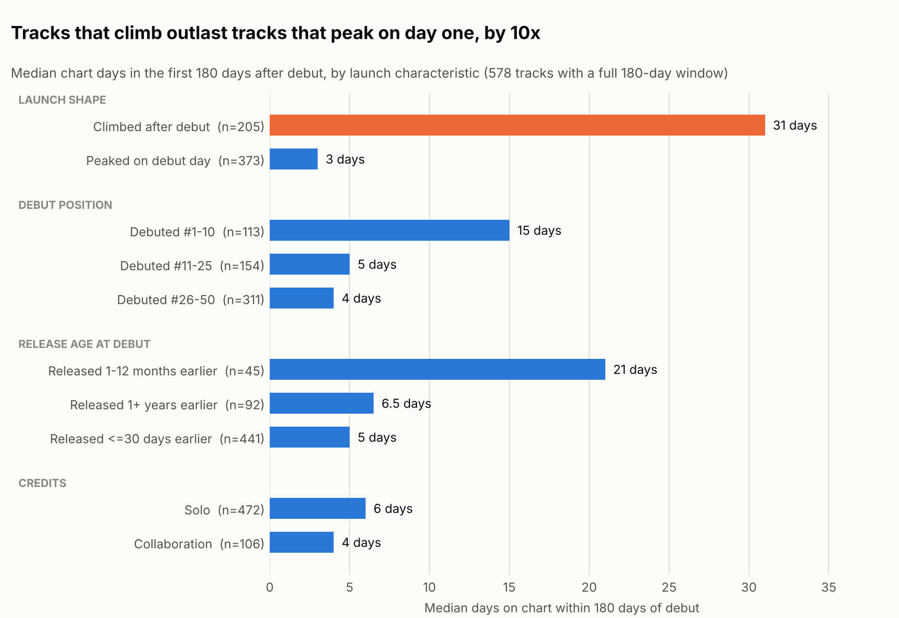
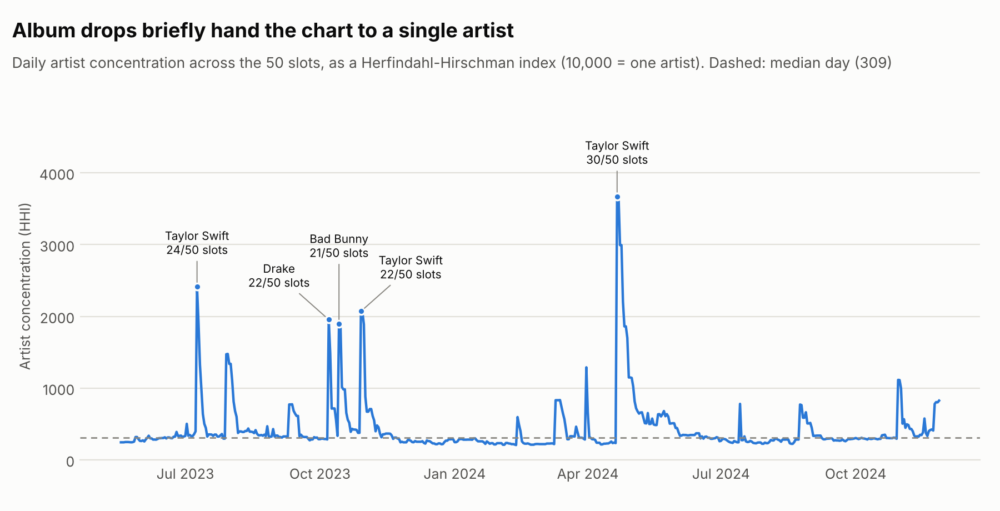
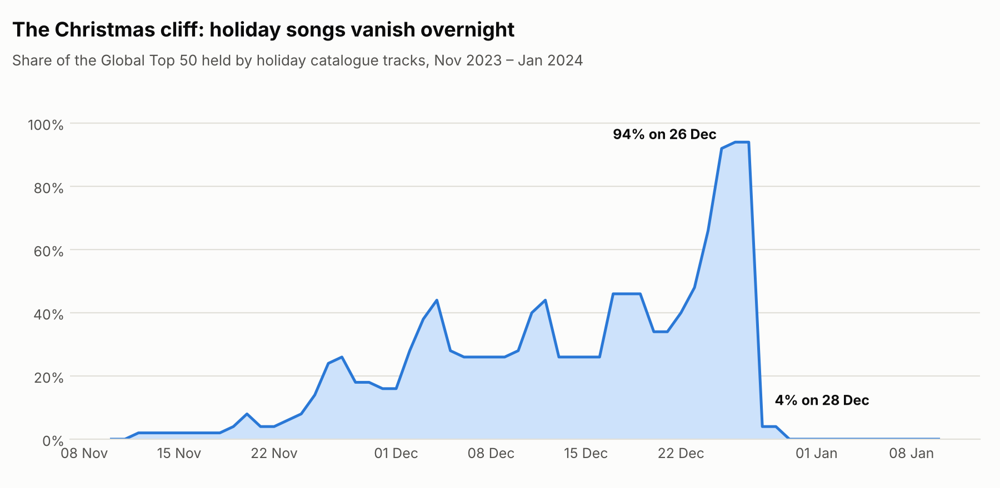
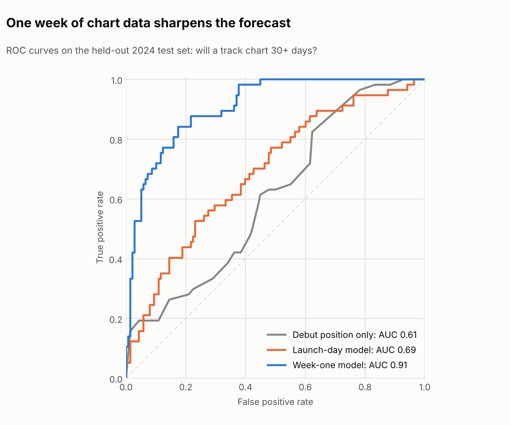
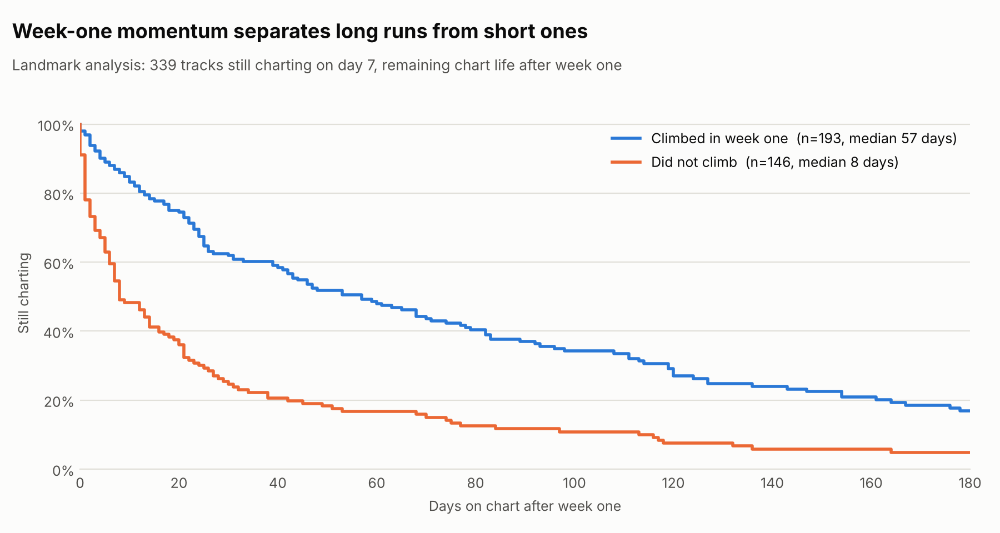
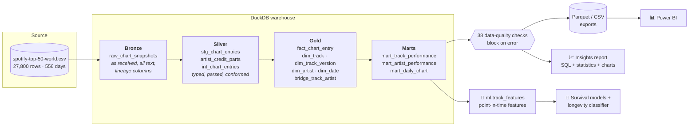
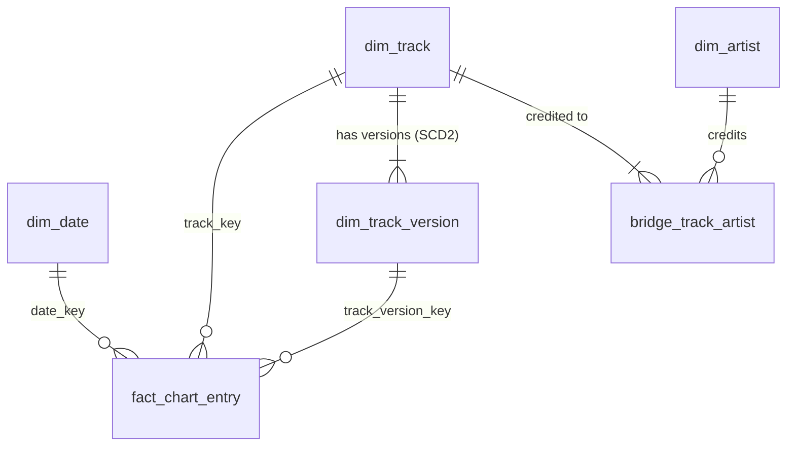
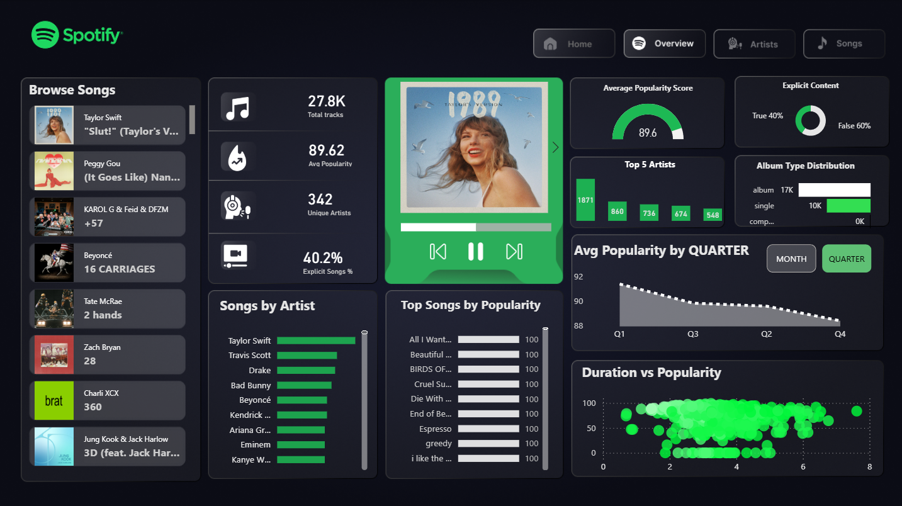
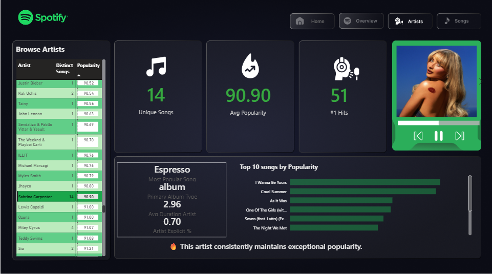
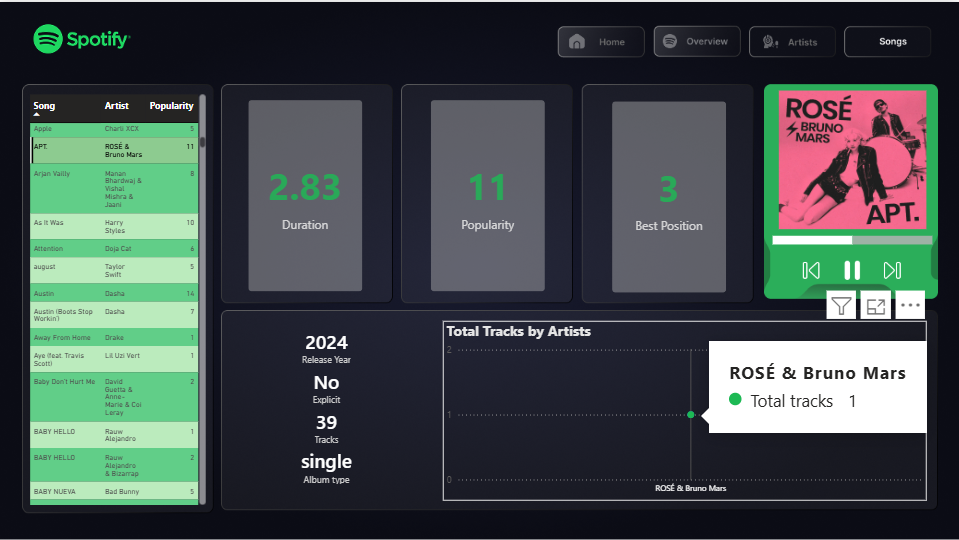

<div align="center">

# 🎵 Spotify Global Top 50: Analytics Platform

### An end-to-end data project on 18 months of daily Spotify charts: a tested ELT pipeline, a star-schema warehouse, statistical analysis, survival models and a chart-longevity predictor, with a Power BI dashboard on top.

<p>
  <a href="https://github.com/n3h4a/spotify-powerbi-dashboard/actions/workflows/ci.yml"></a>
  
  
  
  
  
  
</p>



</div>

---

## 📌 At a glance

| | |
|---|---|
| **Data** | 556 daily snapshots of the Spotify Global Top 50, **May 2023 to Nov 2024** (27,800 chart entries) |
| **Pipeline** | Python + SQL on DuckDB, **bronze → silver → gold** layers, one-command rebuild in under 1 s |
| **Model** | Star schema: 1 fact, 4 dimensions (incl. a **Type 2 slowly changing dimension**), 1 bridge table, plus 3 analytics marts |
| **Analysis** | 7 business questions answered in SQL, tested with **Mann-Whitney U** and **Spearman**, written up in a [generated insights report](docs/insights.md) |
| **Data science** | **Survival analysis** (Kaplan-Meier, log-rank, landmark analysis, Cox model) and a **longevity classifier**: test **ROC-AUC 0.91** on a time-based holdout, documented in a [model report](docs/model_report.md) with a model card |
| **Quality** | **42 automated data-quality checks**, run in CI, with a [generated report](docs/data_quality_report.md) |
| **Testing** | 77 tests: unit, integration, corruption tests, a **future-data leakage test**, and a simulation that checks the statistical test is calibrated |
| **BI** | **Power BI as code:** a generated Power BI Project (TMDL model + PBIR report, 38 DAX measures, 4 pages in the original Spotify design) that loads its data from this repo. [Guide](docs/powerbi_guide.md) |

---

## 💡 Key findings

> Full write-up with method, statistical tests and limitations: **[docs/insights.md](docs/insights.md)**

| # | Finding | Evidence |
|---|---|---|
| 1 | **Most hits are fleeting.** The median track charts for 6 days; 54% last a week or less. | The longest-charting 10% of tracks hold 58% of all chart slots |
| 2 | **A day-one peak predicts a short life.** 65% of tracks peak on debut day and last a median 3 days. Tracks that climb after debut last 31. | Mann-Whitney U, p < 0.001, rank-biserial effect size 0.69 |
| 3 | **Debut position is a poor predictor** of how long a track lasts. | Spearman ρ = −0.17 |
| 4 | **Collaborations don't last longer** than solo tracks (median 4 vs 6 days). | p = 0.46, not significant |
| 5 | **Slow burners win.** Tracks charting 1–12 months after release last 4x longer than brand-new releases. | Median 21 vs 5 days |
| 6 | **Album drops take over the chart.** Taylor Swift held 30 of 50 slots on 21 Apr 2024. | Artist HHI 3,669 vs a median day of 309 |
| 7 | **The Christmas cliff.** Holiday songs held 94% of the chart on 26 Dec and 4% two days later. | `mart_daily_chart.holiday_track_share` |

<p align="center">
  
  
</p>

---

## 🤖 Predicting chart longevity

> Full write-up: **[docs/model_report.md](docs/model_report.md)**. It covers framing, leakage controls, validation, survival analysis, a watchlist of recent debuts and a model card.

**Question:** a track has just entered the Global Top 50. Will it chart for 30+ days?

| Model | Information used | Test ROC-AUC [95% CI] | Precision in top 20% |
|---|---|---:|---:|
| Debut position only | Debut position | 0.61 [0.52–0.69] | 40% |
| Launch-day model | 12 features known at debut | 0.71 [0.62–0.78] | 50% |
| **Week-one model** | **+ 7 features from the first week** | **0.91 [0.87–0.95]** | **82%** |

- **Validated like production:** trained on 2023 debuts and tested on 2024 debuts. Features are point-in-time correct, with a test that rebuilds the warehouse with future data appended and asserts no feature changes. Model selection happens inside the training set only.
- **Survival analysis instead of dropping unfinished cases:** tracks still charting when the data ends are *censored*. A landmark analysis at day 7 avoids immortal-time bias. Tracks that climbed in week one go on to chart a median **57 more days**, against **8** for those that didn't (log-rank p < 0.001).
- **The proportional-hazards check is itself tested:** a simulation confirms it fires about 5% of the time when the assumption holds and catches real violations.

<p align="center">
  
  
</p>

---

## 🏗 Architecture



| Layer | What happens | Why |
|---|---|---|
| **Bronze** | The file lands untouched, as text, with source-file and row-number lineage. | Ingestion can never fail on a bad value, and every row is traceable to its source line. |
| **Silver** | Types are cast, release dates parsed, collaboration credits split into individual artists, and each row resolved to a stable track identity. | Cleaning rules live in one place and are unit-tested. |
| **Gold** | Star schema with documented grain and enforced keys. | Ready for BI, SQL analysis and ML features without re-cleaning. |
| **Marts** | Business-level tables: one row per track (debut, peak, longevity, censoring flags), per artist and per day. | Analysts and dashboards query answers, not joins. Each mart reconciles exactly to the fact table. |

---

## 🚀 Quickstart

```bash
git clone https://github.com/n3h4a/spotify-powerbi-dashboard.git
cd spotify-powerbi-dashboard
make install   # pip install -e ".[dev]"
make all       # build warehouse → run quality checks → export tables
make insights  # run the analyses → docs/insights.md + docs/figures/
make model     # survival analysis + classifier → docs/model_report.md
make powerbi   # regenerate the Power BI project in powerbi/
make test      # 77 tests
```

```text
bronze raw_chart_snapshots      27800 rows     91 ms
silver stg_chart_entries        27800 rows     71 ms
silver artist_credit_parts        487 rows    471 ms
silver int_chart_entries        27800 rows     90 ms
gold   dim_date                   731 rows     84 ms
gold   dim_artist                 346 rows      9 ms
gold   dim_track                  807 rows      6 ms
gold   dim_track_version         1079 rows     34 ms
gold   bridge_track_artist       1003 rows     12 ms
gold   fact_chart_entry         27800 rows     68 ms
marts  mart_track_performance     807 rows     22 ms
marts  mart_artist_performance    346 rows     17 ms
marts  mart_daily_chart           556 rows     16 ms
ml     track_features             757 rows     51 ms
```

Query the warehouse directly with the DuckDB CLI or Python:

```python
import duckdb
con = duckdb.connect("warehouse/spotify.duckdb", read_only=True)
con.sql("SELECT * FROM gold.fact_chart_entry LIMIT 5").show()
```

---

## 🧩 Data model



**`fact_chart_entry`** has one row per chart day × position, plus chart-movement metrics
computed with SQL window functions: `previous_position`, `position_change`,
`entry_status` (debut / re-entry / returning), `current_streak_days` and
`peak_position_to_date`.

📖 Full reference: **[Data model & design decisions](docs/data_model.md)** · **[Data dictionary](docs/data_dictionary.md)**

### Engineering decisions worth reading

1. **Track identity without a track ID.** One recording's artist credit changes over time (`Drake & SZA` → `Drake`), so `(song, artist)` is the wrong key. Tracks are keyed on *(title, lead artist)*, and a uniqueness check confirms no two recordings collide.
2. **SCD Type 2.** 16% of tracks change attributes while charting, typically when a single is re-released on an album. `dim_track_version` keeps every version with validity windows (gaps-and-islands SQL), so reports reflect what was true *on that day*.
3. **Fair credit for collaborations.** A bridge table with `attribution_weight = 1/n` shares chart metrics between collaborators with no double counting. 18% of chart entries are collaborations.
4. **Missing days don't distort the metrics.** Movement is measured against the previous *snapshot*, so the 4 missing source days don't show up as false drop-outs.
5. **Deterministic keys.** Keys are hashed from natural keys, so rebuilds are idempotent (tested).

---

## ✅ Data quality

Every run executes **42 checks** in 7 categories: completeness, validity, uniqueness,
referential integrity, business rules, reconciliation (marts and ML features) and source profiling. Any failed `error` check
returns a non-zero exit code and turns CI red. The results go to
**[docs/data_quality_report.md](docs/data_quality_report.md)**, and CI fails if the
committed report is out of date.

**What profiling found in the raw data:**

| Finding | Impact | Handling |
|---|---|---|
| Mixed **CRLF / LF** line endings (first day saved separately) | Strict CSV parsers reject the file | Tolerant bronze read + independent row-count reconciliation |
| **4 missing days** (e.g. 2024-03-14) | Naive day-over-day metrics show false drop-outs | Snapshot-based movement metrics; flagged in `dim_date` |
| Artist credits **drift** for the same recording | Wrong track counts if keyed on the credit | Track = title + lead artist |
| `" & "` joins collaborators **and** appears inside band names (*Earth, Wind & Fire*) | Naive splitting invents artists | Splitting with a configurable protected-names seed |
| Release dates in 3 precisions (`2023-04-28`, `2019-05`, `1962`) | Misleading "days since release" | Normalised date + `release_date_precision` |
| **19 tracks flip** between single and album releases from day to day | Noisy attributes | Faithfully versioned in SCD2; documented |

---

## 📊 Power BI dashboard

### Power BI as code

**[`powerbi/Spotify Charts Analytics.pbip`](powerbi/)** is a **Power BI Project**: the semantic
model is in TMDL and the report in PBIR JSON. It is generated from the warehouse by
`make powerbi`, version-controlled, and reviewed as text diffs. It contains:

- a **9-table star-schema model** with single-direction relationships, a marked date table
  and **38 documented DAX measures** (including fair collaboration credit through the bridge
  table, and point-in-time SCD2 measures)
- **the original Spotify-style design, kept intact:** the generator reads the hand-designed
  dashboard below straight from its `.pbix` (backgrounds, cards, icons, album-cover player,
  navigation buttons, theme) and re-binds every visual to the tested star schema
- data that **loads straight from this repo**: open the `.pbip` in Power BI Desktop, click
  *Refresh*, and it works on any machine

Every report file was validated against Microsoft's published JSON schemas, and
[tests](tests/test_powerbi.py) check that every visual field and DAX reference resolves.
See the **[Power BI guide](docs/powerbi_guide.md)**.

### Original dashboard (`dashboard/spotify_dashboard.pbix`)

<details open>
<summary><b>🏠 Home</b>: navigation hub</summary>
<p align="center"></p>
</details>

<details>
<summary><b>📊 Overview</b>: KPIs, album-type mix, quarterly popularity trend, duration vs popularity</summary>
<p align="center"></p>
</details>

<details>
<summary><b>🎤 Artist analysis</b>: rankings, unique songs, top tracks per artist</summary>
<p align="center"></p>
</details>

<details>
<summary><b>🎵 Song analysis</b>: popularity, duration, best chart position, release year</summary>
<p align="center"></p>
</details>

These screenshots show the design. The generated project keeps this exact look, with
every visual now powered by the star schema: correctly counted artists, weighted
collaboration credit, chart journeys and longevity insights.

---

## 📂 Repository structure

```text
spotify-powerbi-dashboard/
├── dataset/                  # raw source CSV
├── seeds/                    # analyst-maintained reference data
├── sql/
│   ├── bronze/               # raw landing
│   ├── silver/               # typing, parsing, conforming
│   ├── gold/                 # star schema (facts, dimensions, bridge)
│   ├── marts/                # track, artist and daily analytics tables
│   ├── analyses/             # one SQL file per business question
│   └── ml/                   # point-in-time feature table
├── src/spotify_pipeline/
│   ├── pipeline.py           # orchestration: ordered, timed, idempotent steps
│   ├── artists.py            # collaboration-credit parser
│   ├── quality.py            # data-quality framework + report
│   ├── insights.py           # statistics, charts and the insights report
│   ├── modeling.py           # survival analysis, classifiers, model report
│   ├── powerbi.py            # generates the Power BI Project
│   └── cli.py                # `spotify-pipeline build | check | export | insights | model | powerbi | all`
├── tests/                    # pytest: unit, integration, corruption tests
├── docs/                     # model report, insights, data model, dictionary, quality report, Power BI guide
│   └── figures/              # generated charts
├── powerbi/                  # Power BI Project (.pbip): TMDL model, PBIR report, data
├── dashboard/                # Power BI .pbix
├── screenshots/
├── .github/workflows/ci.yml  # lint → test → build → enforce data quality
├── Makefile
└── pyproject.toml
```

---

## 🗺 Roadmap

- [x] **Phase 1: Data engineering.** Layered ELT, star schema with SCD2, data-quality framework, tests, CI
- [x] **Phase 2: Analytics.** Marts, 7 business questions in SQL, significance testing, generated insights report, Power BI model guide and DAX measures
- [x] **Phase 3: Data science.** Survival analysis (Kaplan-Meier, log-rank, landmark, Cox) and a week-one longevity classifier with time-based validation, bootstrap CIs and permutation importance
- [ ] Time-varying Cox model for the covariates whose effects change over the chart life
- [ ] Enrich features with audio attributes from a public dataset (fuzzy matching on title and artist)
- [ ] Incremental, date-partitioned loads and orchestration once the source grows beyond a single file

---

## 🛠 Tech stack

| Area | Tools |
|---|---|
| Storage & compute | DuckDB (embedded OLAP, columnar) |
| Transformation | SQL (CTEs, window functions, gaps-and-islands), Python |
| Analysis | SQL, SciPy (Mann-Whitney U, Spearman), Matplotlib |
| Machine learning | scikit-learn (logistic regression, gradient boosting, permutation importance), statsmodels (Kaplan-Meier, log-rank, Cox PH) |
| Data quality | Custom SQL-assertion framework with severities and a generated report |
| Testing & CI | pytest, ruff, GitHub Actions |
| BI | Power BI: PBIP project format (TMDL, PBIR), Power Query M, DAX |

---

## 👩‍💻 Author

**Neha Karamchandani**: B.Tech, Information Technology

Interested in data engineering, analytics and data science.

<div align="center">

⭐ If you found this project useful, consider giving it a star!

</div>
