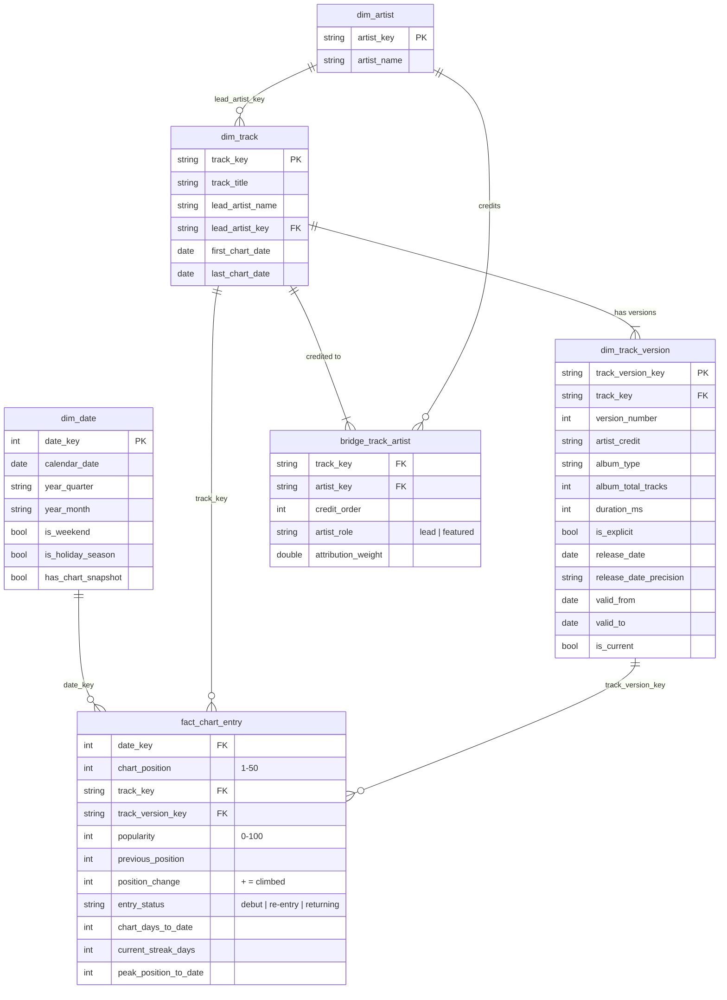

# Data Model & Design Decisions

This document explains **how** the warehouse is modelled and, more importantly, **why**.
For column-level definitions, see the [data dictionary](data_dictionary.md).

---

## 1. Layered architecture (medallion)

| Layer | Schema | Purpose | Contract |
|---|---|---|---|
| **Bronze** | `bronze` | Land the source exactly as received, plus lineage (`_source_file`, `_source_row_number`, `_loaded_at`). | Every column is `VARCHAR`. Nothing is rejected, so ingestion never fails because of a bad value. |
| **Silver** | `silver` | Type, clean and conform. Parse artist credits and resolve each row to a stable track identity. | Typed columns. Bad casts become `NULL` and are caught by the quality suite. |
| **Gold** | `gold` | Star schema for BI, SQL analytics and machine learning. | Documented grain, unique keys, enforced relationships. |
| **ML** | `ml` | Point-in-time feature table for survival analysis and prediction. | No feature uses data after its prediction time (tested by rebuilding with future data appended). |
| **Marts** | `marts` | Business-level answers: one row per track, artist and day, with censoring flags for honest statistics. | Each mart reconciles exactly to the fact table (enforced by quality checks). |

Each model is a full, idempotent rebuild (`CREATE OR REPLACE`). With 27.8K rows, the
whole warehouse rebuilds in under a second, so incremental loading would add complexity
with no benefit. The [roadmap](../README.md#-roadmap) covers when that would change.

---

## 2. Star schema

**Fact grain:** one row per chart date × chart position (27,800 rows = 556 snapshots × 50).

---

## 3. Key design decisions

### 3.1 Track identity without a track ID

The source has no Spotify track ID, and the obvious key, `(song, artist)`, is wrong.
The artist credit for the *same recording* changes over time:

| Song | Credits seen in the source |
|---|---|
| Slime You Out (feat. SZA) | `Drake & SZA` → `Drake` |
| Seven (feat. Latto) (Explicit Ver.) | `Jung Kook & Latto` → `Jung Kook & Latto & BTS` → … |
| un x100to | `Grupo Frontera & Bad Bunny` → `Grupo Frontera` |

Keying on the full credit would split one song into several "tracks" and break chart-run
metrics. Instead, **track = (title, lead artist)**: the lead artist stays the same even
when featured credits change. The `track_charts_once_per_day` check validates the rule:
if two different recordings collided on one key, a key would sometimes appear twice in
one day's chart. It never does.

One refinement: occasionally the *lead* credit changes too. On 16 Feb 2024 Spotify
re-credited seven *Vultures 1* songs from "Kanye West" to his duo "¥$", and three
songs were re-listed on compilations under "Various Artists". An identical title **and
an identical duration (to the millisecond)** identifies these as one recording, which is
credited to the lead it charted under most. A quality check (`no_split_recordings`)
keeps it that way, and "Various Artists" never takes credit from a real artist. The
source resolves into **797 tracks**.

### 3.2 Slowly Changing Dimension Type 2 for track attributes

While a song charts, its descriptive attributes change: a single is re-released on an album
(`album_type`, `album_total_tracks`, cover art and release date change), a featured artist
is dropped, or the explicit flag flips. **140 of 797 tracks (18%) change at least once.**

`dim_track_version` stores each unbroken run of identical attributes as a version with a
`[valid_from, valid_to]` window. This is the classic **gaps-and-islands** pattern:

1. Hash all mutable attributes per track per day (`version_attributes_hash`).
2. Flag a change when the hash differs from the previous chart day (`lag`).
3. A running `sum` of the flags numbers the versions.
4. `valid_to` = the next version's `valid_from` − 1 day (`lead`). The current version is open-ended (`9999-12-31`).

Each fact row stores the `track_version_key` that was valid that day, so a report on
"singles vs albums" uses what was true *at the time*, not what is true today.

> **Source quirk:** for 21 tracks the chart flips back and forth between the single and the
> album release of the same song (*Too Sweet* has 26 versions). SCD2 records this faithfully
> and the quality report lists it. For analysis that needs one stable attribute per track,
> filter `dim_track_version` on `is_current`.

### 3.3 Collaborations: a bridge table with attribution weights

18% of chart entries are collaborations. A plain `artist` column would either miscount
artists (`"Drake & SZA"` treated as one artist) or double count streams when split.
`bridge_track_artist` resolves the many-to-many relationship, and `attribution_weight =
1 / n_artists` lets analysts share a track's metrics between its artists. Weighted
totals across all artists add up exactly to the track total; the
`attribution_weights_sum_to_one` check enforces this.

Credits are split on `" & "`, except for names in
[`seeds/protected_artist_names.csv`](../seeds/protected_artist_names.csv), such as
*Earth, Wind & Fire*. Analysts can extend that list without touching code.

### 3.4 Movement metrics use snapshots, not calendar days

4 days are missing from the source (see the [quality report](data_quality_report.md)).
If "yesterday" meant the previous calendar day, every track would appear to drop out
of the chart and re-enter the day after a gap. `fact_chart_entry` therefore numbers the
snapshots and compares each entry with the **previous snapshot**. Streaks also use
gaps-and-islands: `snapshot_seq − row_number()` is constant within a consecutive run.

### 3.5 Deterministic surrogate keys

Keys are MD5 hashes of natural keys (`md5('track|' || title || '|' || lead_artist)`), not
auto-increment integers. Rebuilding the warehouse, or loading new data later, always gives
the same keys, so downstream reports and ML features never silently re-key. A test checks
that a rebuild produces identical output.

### 3.6 Release dates with mixed precision

`release_date` arrives as `2023-04-28`, `2019-05` or `1962`. It is normalised to the first
day of its period, and `release_date_precision` (`day` / `month` / `year`) is kept, so a
"days from release to chart" metric can exclude imprecise dates instead of quietly
treating `1962` as 1 January 1962.

### 3.7 A calendar dimension that covers whole years

`dim_date` covers whole calendar years (2023-01-01 to 2024-12-31), because Power BI's
time-intelligence functions need a continuous date table. `has_chart_snapshot` shows
which days actually have data, and `is_holiday_season` makes the Christmas-music effect
easy to segment.
