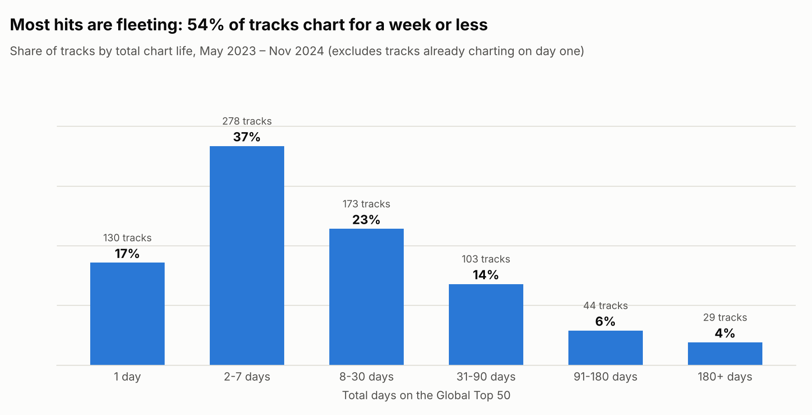
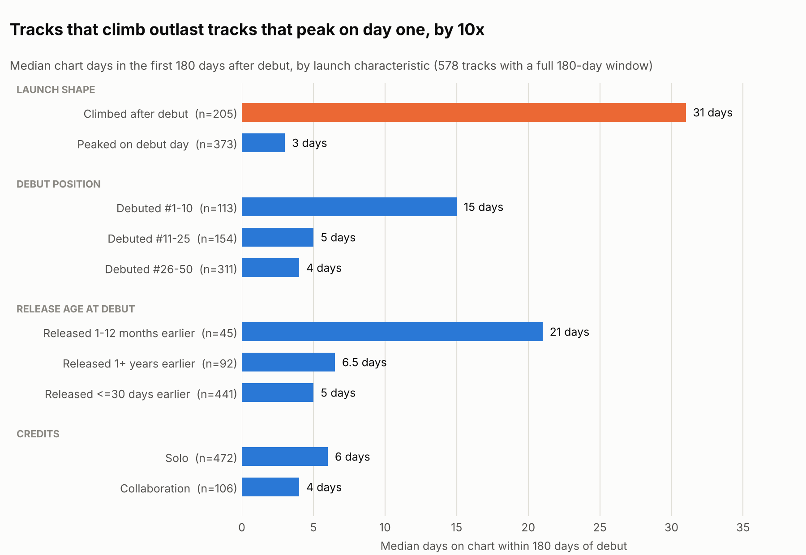
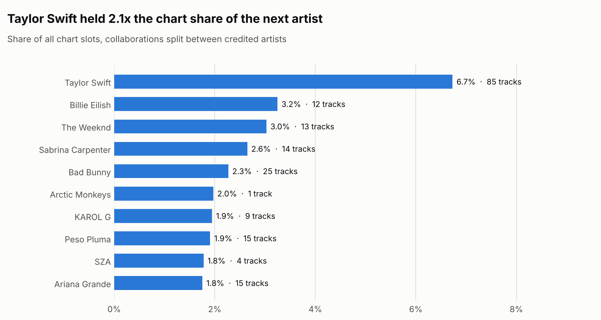
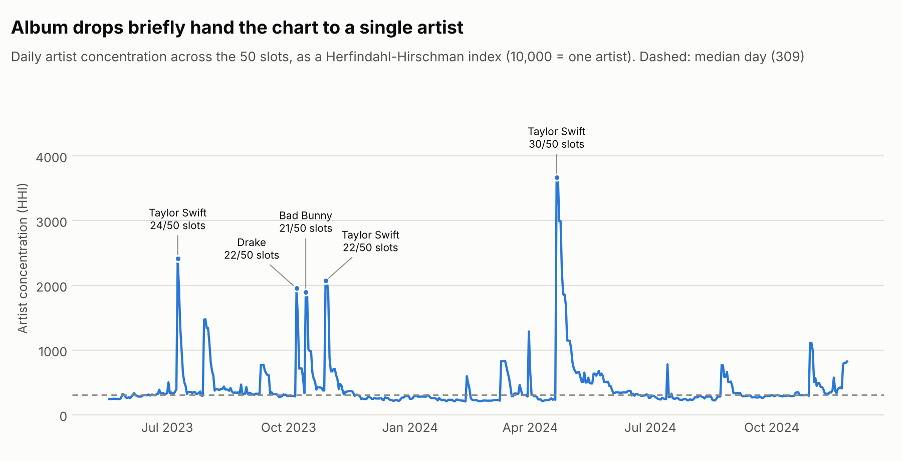
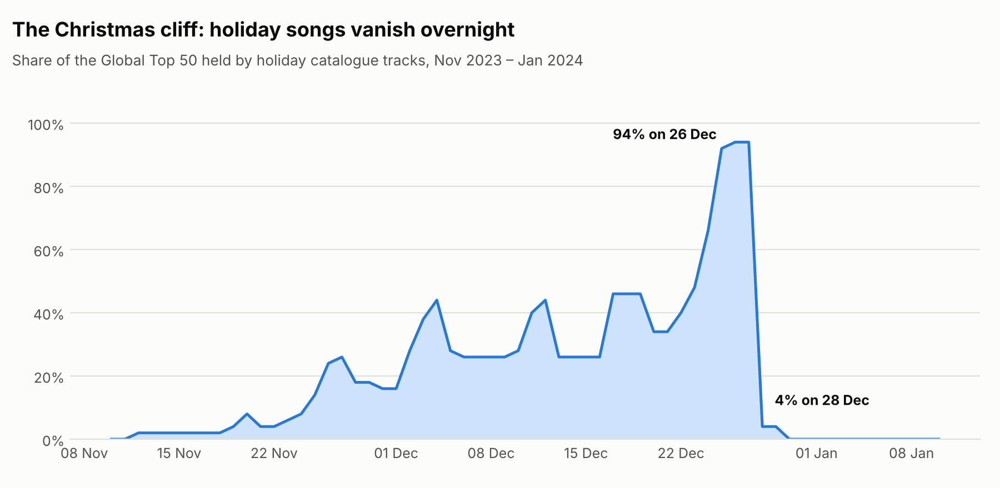

# Insights: What Makes a Global Top 50 Hit Last?

> Generated by `spotify-pipeline insights` from the warehouse marts. Every number below is computed, not typed; rerun the command to refresh it. The SQL behind each answer is linked.

## Executive summary

1. **Chart life is short and extremely uneven.** The median track lasts **6 days**; 17% last a single day. The longest-charting 10% of tracks hold **58% of all chart slots**.
2. **A day-one peak predicts a short life.** 65% of tracks peak on debut day. They spend a median **3 days** on the chart in their first 180 days, against **31 days** for tracks that climbed after debuting (p < 0.001, effect size 0.69).
3. **Debut position is a poor predictor of longevity** (Spearman ρ = -0.17, weak). Top-10 debuts last longer (median 15 days vs 4), but launch *momentum* matters more than launch *height*.
4. **Collaborations do not last longer.** Median 4 vs 6 days; the difference is not statistically significant (p = 0.46).
5. **Slow burners win.** Tracks that reached the chart 1–12 months after release last a median **21 days**, against 5 for brand-new releases.
6. **Album drops take over the chart.** On 21 Apr 2024, Taylor Swift held **30 of 50 slots** (HHI 3,669 against a typical 309). 3 of the 5 takeover events were Taylor Swift releases.
7. **The Christmas cliff.** Holiday songs held **94%** of the chart on 26 Dec 2023 and 4% on 28 Dec.

## Method

- **Source:** the gold star schema and marts built by this pipeline (807 tracks, 556 daily snapshots).
- **Censoring.** The data is a window into an ongoing chart. Tracks already charting on the first snapshot have unknown debuts (*left-censored*), and tracks still charting on the last snapshot have unfinished lives (*right-censored*). Ignoring this would understate how long recent tracks last.
- **Analysis cohort (578 tracks):** tracks with a known debut and a full 180 days of follow-up. Longevity is compared on *chart days within 180 days of debut*, the same observation window for every track ([cohort.sql](../sql/analyses/cohort.sql)).
- **Statistics:** chart-day counts are heavily right-skewed, so groups are compared with medians and the two-sided **Mann-Whitney U test** (no normality assumption). Effect size is the rank-biserial correlation. Rank association uses **Spearman's ρ**.
- **Holiday tracks** are tracks with at least 90% of their chart days between 15 Nov and 31 Dec that were released more than a year before debuting.

---

## Q1. How long do tracks survive on the chart?

Of 757 tracks with a known debut, 54% spend a week or less on the chart. The distribution has a long tail: the top 10% of all tracks account for 58% of chart slots and the bottom half for 3.9%.

| Chart life | Tracks | Share |
|---|---|---|
| 1 day | 130 | 17.2% |
| 2-7 days | 278 | 36.7% |
| 8-30 days | 173 | 22.9% |
| 31-90 days | 103 | 13.6% |
| 91-180 days | 44 | 5.8% |
| 180+ days | 29 | 3.8% |

SQL: [q1_longevity_distribution.sql](../sql/analyses/q1_longevity_distribution.sql) · [q2_hit_concentration.sql](../sql/analyses/q2_hit_concentration.sql)

## Q2. Which launch characteristics go with a longer life?

| Dimension | Segment | Tracks | Median days (first 180) | Reached 30+ days |
|---|---|---|---|---|
| Credits | Solo | 472 | 6 | 24% |
| Credits | Collaboration | 106 | 4 | 23% |
| Debut position | Debuted #1-10 | 113 | 15 | 34% |
| Debut position | Debuted #11-25 | 154 | 5 | 14% |
| Debut position | Debuted #26-50 | 311 | 4 | 25% |
| Launch shape | Climbed after debut | 205 | 31 | 52% |
| Launch shape | Peaked on debut day | 373 | 3 | 8% |
| Release age at debut | Released 1-12 months earlier | 45 | 21 | 47% |
| Release age at debut | Released 1+ years earlier | 92 | 6.5 | 27% |
| Release age at debut | Released <=30 days earlier | 441 | 5 | 21% |

| Comparison | Medians | Test | Effect size |
|---|---|---|---|
| Climbed after debut vs Peaked on debut day | 31 vs 3 days | Mann-Whitney U, p < 0.001 | 0.69 (large) |
| Collaboration vs Solo | 4 vs 6 days | Mann-Whitney U, p = 0.46 | 0.05 (negligible) |
| Debut position vs chart days | n = 578 | Spearman ρ = -0.17, p < 0.001 | weak |

**Reading it.** Most new releases debut at their peak and then fall away, which fits a release-day burst of streams from existing fans. Tracks that *climb* after debuting are still gaining listeners, and they last about 10 times longer. Debut position is a much weaker predictor. The strongest single signal, launch shape, is only known after the first few days. That gives Phase 3's model a clear target: predict longevity from **early momentum** (position change over the first week), not from debut position alone.

SQL: [q3_segment_longevity.sql](../sql/analyses/q3_segment_longevity.sql)

## Q3. How quickly do tracks reach the chart after release?

Among 643 non-catalogue tracks with exact release dates, the median gap from release to debut is **2 days**: 80% debut within a week and 18% within a day. Global chart success is decided almost immediately, which matches the debut-day peak pattern in Q2.

SQL: [q7_release_timing.sql](../sql/analyses/q7_release_timing.sql)

## Q4. Is the chart dominated by a few artists?

The top 10 artists hold 27% of all chart slots. Day to day, though, the chart is usually diverse. Concentration spikes are rare and tied to specific events:

| Artist | Started | Days | Peak slots (of 50) | Peak HHI |
|---|---|---|---|---|
| Taylor Swift | 2023-07-09 | 2 | 24 | 2,412 |
| Drake | 2023-10-07 | 1 | 22 | 1,955 |
| Bad Bunny | 2023-10-14 | 2 | 21 | 1,893 |
| Taylor Swift | 2023-10-29 | 3 | 22 | 2,071 |
| Taylor Swift | 2024-04-21 | 8 | 30 | 3,669 |

Every takeover lines up with a major album release, and none lasts more than about a week before the chart returns to normal.

SQL: [q4_album_takeovers.sql](../sql/analyses/q4_album_takeovers.sql) · [q6_top_artists.sql](../sql/analyses/q6_top_artists.sql)

## Q5. How seasonal is the chart?

Holiday catalogue songs, most released decades ago, build up through December, peak at 94% of the chart on 26 Dec, and fall to 4% on 28 Dec. Any year-over-year or trend analysis must account for this: December metrics such as average release age or catalogue share are distorted by design. `dim_date.is_holiday_season` and `mart_track_performance.is_holiday_track` make the adjustment a single filter.

SQL: [q5_holiday_cliff.sql](../sql/analyses/q5_holiday_cliff.sql)

---

## Recommendations

For a label, artist team or editorial playlist team using this data:

1. **Judge a release on week-two momentum, not debut position.** A track still climbing after debut is the strongest sign of a long chart life found here.
2. **Back slow burners.** Tracks that find an audience months after release last longest. Catalogue and mid-life tracks deserve promotion budget, not only launches.
3. **Don't count on a feature to extend a song's life.** Collaborations show no longevity advantage. Their value is reach, not staying power.
4. **Plan around album drops and the holidays.** Avoid releasing into a superstar album week, when one artist can hold up to 60% of the chart, and expect December chart space to be largely taken by holiday catalogue.

## Limitations

- The data covers 18 months of a single chart (Global Top 50). Findings may not generalise to regional charts or to streams outside the top 50.
- Chart position is a rank, not a stream count, so the size of a hit can't be measured, only its rank and duration.
- The results are associations, not causal effects. For example, tracks that climb may already be stronger songs.
- The holiday rule depends on release age, so a brand-new Christmas song would be missed, and one seasonal-but-not-Christmas track (*Heather*, Conan Gray) is included.

**Next (Phase 3):** model chart survival directly (Kaplan-Meier, Cox proportional hazards), so censored tracks are used instead of excluded, and predict longevity from first-week signals.
