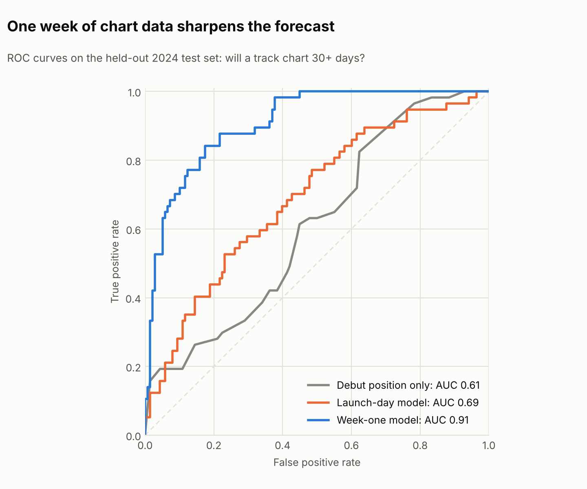
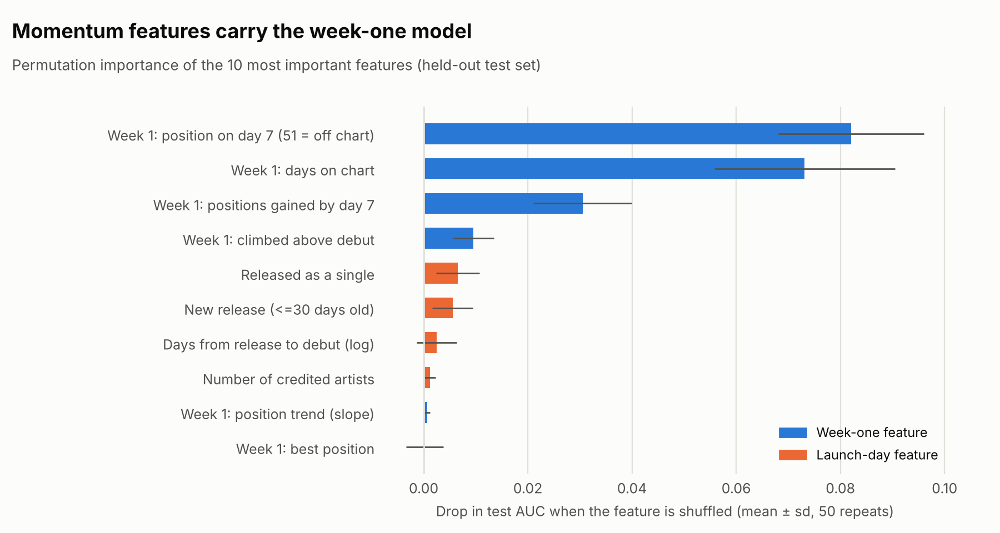
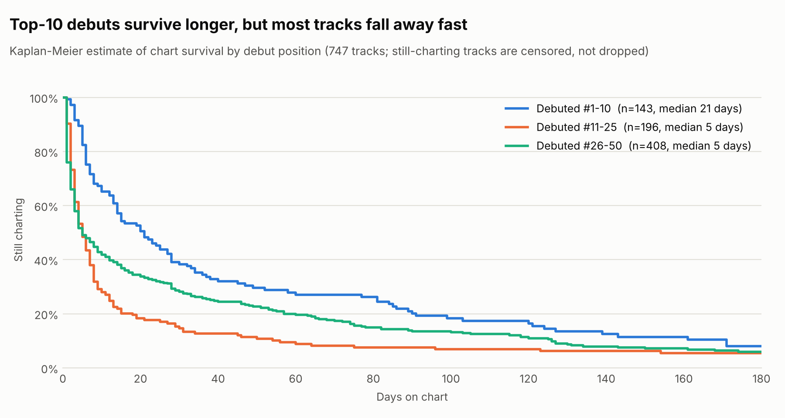
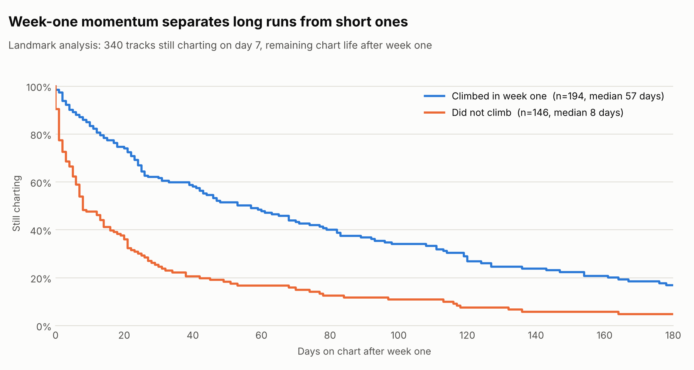
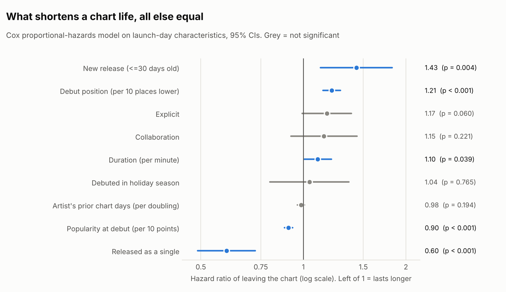

# Model Report: Predicting Chart Longevity

> Generated by `spotify-pipeline model`. All numbers, tables and figures come from the warehouse; rerun the command to refresh them. Source: [`modeling.py`](../src/spotify_pipeline/modeling.py), features: [`track_features.sql`](../sql/ml/track_features.sql).

## Summary

- **A week of chart data is worth more than everything known at launch.** On tracks that debuted in 2024 (held out from training), the week-one model reaches **ROC-AUC 0.91** (95% CI 0.86–0.95), against 0.69 for the launch-day model and 0.61 for debut position alone. The gain is **+0.22 AUC** (95% CI +0.14 to +0.29, paired bootstrap).
- **The model is useful in practice.** Of the 20% of test tracks it ranks highest, 82% went on to chart 30+ days, against a base rate of 29% (**2.8x lift**).
- **Survival analysis agrees.** Half of all tracks leave the chart within **7 chart days**. Among tracks still charting on day 7, those that climbed in week one have a median remaining life of **57 days**, against 8 for those that didn't (log-rank p < 0.001).
- **At launch, 5 of 9 characteristics significantly change survival** in a Cox model: debut position (per 10 places lower) (HR 1.21); popularity at debut (per 10 points) (HR 0.90); new release (<=30 days old) (HR 1.43); released as a single (HR 0.60); duration (per minute) (HR 1.10). The model ranks tracks only moderately well (C-index 0.65), which confirms that launch-day information alone is limited.

---

## 1. Problem framing

| | |
|---|---|
| **Question** | Will a newly charting track spend **30 or more days** on the Global Top 50 within 180 days of its debut? |
| **Why 30 days** | It separates lasting hits from release-week spikes: 24% of labelled tracks reach it. |
| **Unit** | One track with a known debut (tracks already charting on the first day are excluded). |
| **Decision supported** | Which recent releases deserve continued promotion or playlist support, decided one week after debut. |

## 2. Leakage controls and validation design

- **Point-in-time features.** Launch-day features use only the debut snapshot, release metadata and the lead artist's chart history *before* the debut date. Week-one features use only the 7 days after debut. Tests in `tests/test_ml_features.py` check both rules.
- **Labels need a full window.** Tracks debuting in the last 180 days of data have no label, because their outcome isn't known yet. They are scored on a watchlist (section 5) instead of being dropped silently or mislabelled.
- **Time-based split.** Train on debuts before 01 Jan 2024 (n = 376), test on later debuts (n = 195). A random split would let the model learn from tracks released after the ones it predicts.
- **Model selection** uses 5-fold cross-validation inside the training set only. The test set is scored exactly once.
- **Uncertainty.** Confidence intervals come from 2,000 paired bootstrap resamples of the test set.

## 3. Results



| Model | Features | Chosen algorithm | CV AUC (train) | Test AUC [95% CI] | Avg precision | Brier | Precision @ top 20% |
|---|---|---|---:|---:|---:|---:|---:|
| Debut position only | 1 feature | Gradient boosting | 0.557 | 0.610 [0.53–0.69] | 0.430 | 0.204 | 41% |
| Launch-day model | 12 features | Logistic regression | 0.681 | 0.691 [0.61–0.77] | 0.499 | 0.187 | 51% |
| Week-one model | 19 features | Logistic regression | 0.935 | 0.908 [0.86–0.95] | 0.799 | 0.111 | 82% |

Base rate in the test set: 29%. An uninformative model scores AUC 0.50 and average precision 0.292.

**Does momentum really add value?** In a paired bootstrap, the week-one model beats the launch-day model by +0.217 AUC (95% CI +0.142 to +0.292, bootstrap p < 0.001).

### What drives the prediction



Shuffling **week 1: position on day 7 (51 = off chart)** costs the most AUC (0.082). Week-one features account for 92% of the total importance. Permutation importance on the held-out set is model-agnostic, and unlike impurity-based importance it isn't biased towards high-cardinality features.

## 4. Survival analysis

Classification needs a fixed window and drops tracks whose outcome is unknown. Survival analysis keeps every track: those still charting when the data ends are **censored**, meaning they count for as long as they were observed.

- **Time:** total days on chart.
- **Event:** the chart life has ended, meaning the track was absent for at least the last 14 days of data.
- **Tracks:** 747 with a known debut, of which 658 have ended their chart life and 89 are censored.

### Kaplan-Meier by debut position



| Group | Tracks | Exits | Median chart days | Still charting at 30 days | Still charting at 90 days |
|---|---:|---:|---:|---:|---:|
| All tracks | 747 | 658 | 7 | 27% | 13% |
| Debuted #1-10 | 143 | 122 | 21 | 38% | 20% |
| Debuted #11-25 | 196 | 178 | 5 | 15% | 8% |
| Debuted #26-50 | 408 | 358 | 5 | 28% | 14% |

Log-rank test across the three groups: χ² = 28.6, p < 0.001.

### Landmark analysis: does week-one momentum matter?



Comparing tracks that climbed in week one with those that didn't, from debut, would be biased: a track has to *survive* in order to climb (**immortal-time bias**). The landmark design avoids this. Only tracks still charting on day 7 are compared, and survival is measured from that point.

| Group | Tracks | Exits | Median remaining chart days | At 30 days | At 90 days |
|---|---:|---:|---:|---:|---:|
| Climbed in week one | 194 | 149 | 57 | 62% | 37% |
| Did not climb | 146 | 134 | 8 | 25% | 12% |

Log-rank test: χ² = 50.7, p < 0.001.

### Cox proportional-hazards model (launch-day covariates)



A hazard ratio (HR) above 1 means the track tends to leave the chart sooner.

| Covariate | HR | 95% CI | p | PH check p |
|---|---:|---|---:|---:|
| Debut position (per 10 places lower) | 1.21 | 1.14–1.29 | < 0.001 | < 0.001 |
| Popularity at debut (per 10 points) | 0.90 | 0.88–0.93 | < 0.001 | 0.485 |
| New release (<=30 days old) | 1.43 | 1.12–1.82 | 0.004 | 0.081 |
| Collaboration | 1.15 | 0.92–1.44 | 0.221 | 0.401 |
| Explicit | 1.17 | 0.99–1.38 | 0.060 | 0.943 |
| Released as a single | 0.60 | 0.49–0.72 | < 0.001 | 0.088 |
| Duration (per minute) | 1.10 | 1.00–1.21 | 0.039 | 0.771 |
| Debuted in holiday season | 1.04 | 0.80–1.36 | 0.765 | 0.098 |
| Artist's prior chart days (per doubling) | 0.98 | 0.96–1.01 | 0.194 | < 0.001 |

Concordance (Harrell's C): **0.65**. The *PH check* tests whether each covariate's effect is constant over time, by correlating its Schoenfeld residuals with time. 2 covariate(s) show a time-varying effect (debut position (per 10 places lower), artist's prior chart days (per doubling)). Their hazard ratios are averages over the chart life and should be read as such. A stratified or time-varying Cox model is the natural next step.

## 5. Watchlist: recent debuts scored by the final model

The final week-one model is refit on all labelled tracks and scores the tracks that debuted too recently to have a label. These are genuine forecasts:

| Track | Lead artist | Debut | Debut pos. | Day-7 pos. | P(30+ days) | Chart days so far |
|---|---|---|---:|---:|---:|---:|
| Bye Bye Bye - From Deadpool and Wolverine Soundtrack | *NSYNC | 2024-07-29 | 38 | 12 | 97% | 66 |
| Numb | Linkin Park | 2024-09-08 | 44 | 22 | 95% | 28 |
| Tu Boda | Oscar Maydon | 2024-10-15 | 39 | 5 | 95% | 44 |
| The Emptiness Machine | Linkin Park | 2024-09-08 | 7 | 6 | 95% | 76 |
| Big Dawgs | Hanumankind | 2024-08-01 | 48 | 14 | 94% | 64 |
| Please Please Please | Sabrina Carpenter | 2024-06-09 | 6 | 1 | 94% | 170 |
| APT. | ROSÉ | 2024-10-20 | 3 | 1 | 93% | 39 |
| Rockstar | LISA | 2024-06-30 | 14 | 12 | 93% | 46 |
| REAL GANGSTA LOVE | Trueno | 2024-06-09 | 35 | 16 | 92% | 70 |
| Diet Pepsi | Addison Rae | 2024-10-03 | 50 | 30 | 91% | 31 |

## 6. Model card

| | |
|---|---|
| **Model** | Logistic regression, 19 features |
| **Training data** | 571 labelled tracks (debuts 2023-05-19 to 2024-05-31) |
| **Intended use** | Ranking newly charting tracks by their likelihood of lasting, one week after debut |
| **Not intended for** | Predicting stream counts, regional charts, or tracks outside the Global Top 50 |
| **Known limitations** | Small sample; a single 18-month window; artist history only visible inside the dataset window, so early debuts have less of it; associations, not causal effects |
| **Monitoring** | Recompute the test AUC as new labels mature, and retrain if it drops below the launch-day model |

## Reproduce

```bash
make install   # includes the ml extra
make all       # build the warehouse, including ml.track_features
make model     # regenerates this report and figures 06-10
```
